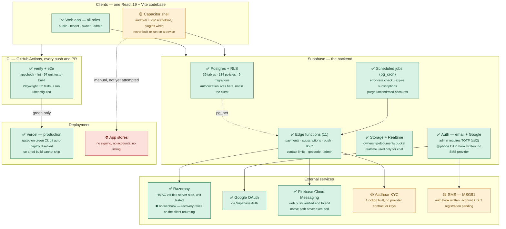

# Bhavan — Architecture

Counts and statuses verified against the repo and the live Supabase
project on 2026-08-04. See [HANDOVER.md](HANDOVER.md) for what is left to
do and why.

**Status key** — `✅` live and verified · `🟡` built, not wired up · `⛔` not started

## Corrections against the previous diagram

| Previously shown | Actual |
|---|---|
| 34 tables, 119 RLS policies | **39 tables, 134 policies** |
| Edge functions (7) | **11** |
| Auth: "email, Google, phone OTP" | email and Google are live; **phone OTP is not wired** — no SMS provider |
| Razorpay "live & verified" | signature verification is real and tested, but **no webhook**, and whether the keys are live or test is unconfirmed |
| Auto-deploy: "no deploy step yet" | **Vercel deploy exists**, gated on CI |
| Web hosting: "not configured in this repo" | **`vercel.json` present and wired** |
| CI: typecheck, lint, test, build | plus **Playwright E2E**, which deploys are gated on |
| *(absent)* | **Firebase Cloud Messaging** — a live dependency |
| *(absent)* | **pg_cron / pg_net** — scheduled jobs and push dispatch run inside Postgres |
| "Manual Capacitor builds" | projects **scaffolded and plugin-wired**, but never built or run |

## Two things the boxes don't convey

**Authorization is in the database.** The client talks to PostgREST directly
with the anon key; what a user may read or write is decided by RLS
policies. A change to a table's policies is a security change even when no
TypeScript moves. Anything the client must not control — payment amounts,
plan prices, payment status, contact limits — lives in an edge function
holding the service-role key.

**There is one Supabase project and it is production.** Every migration was
applied to it directly and the E2E suite points at it. The layers above
imply an environment boundary that does not exist yet; standing up staging
is the first task in the handover.
