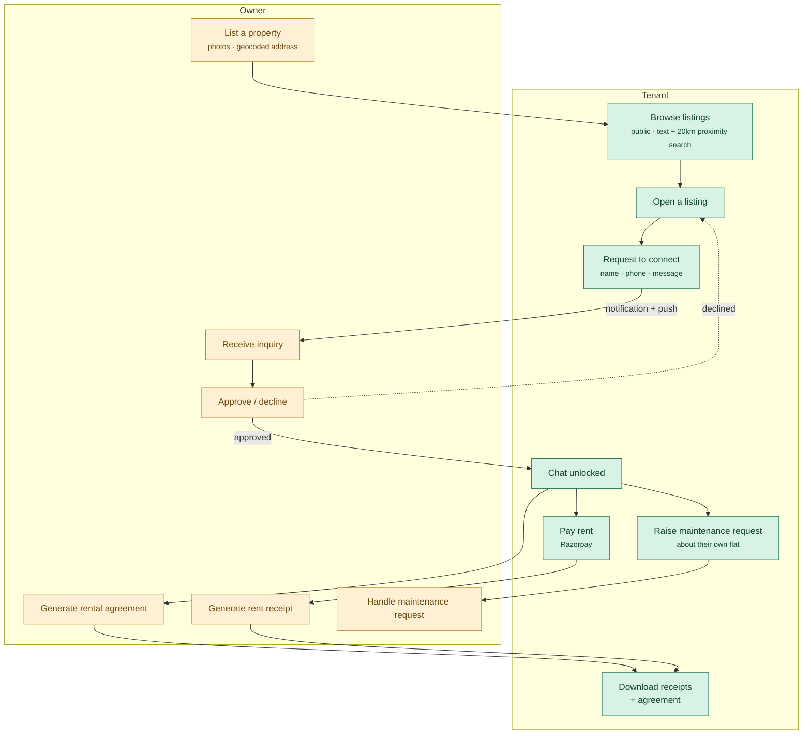
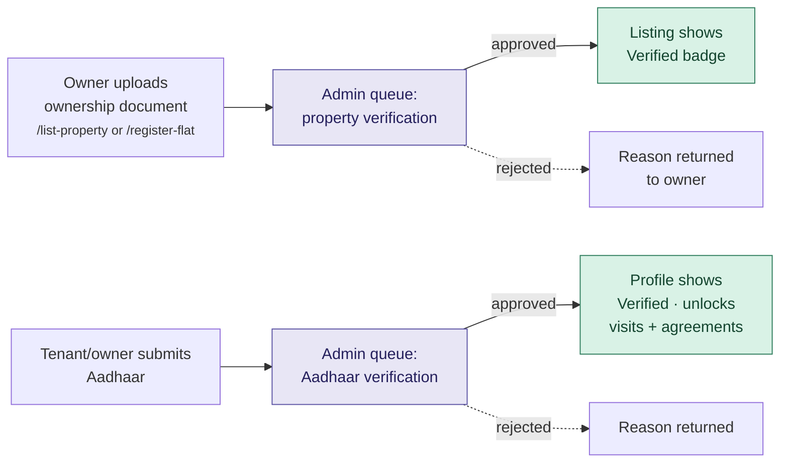
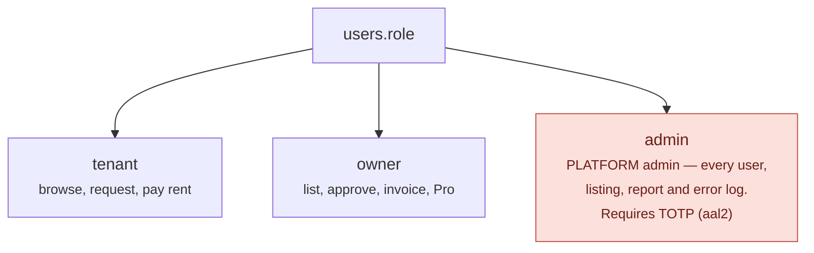
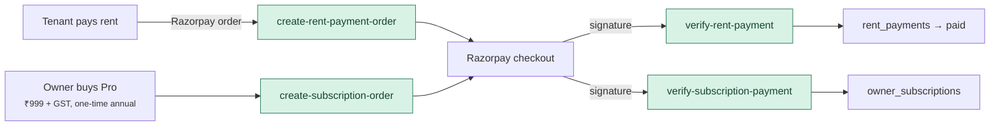
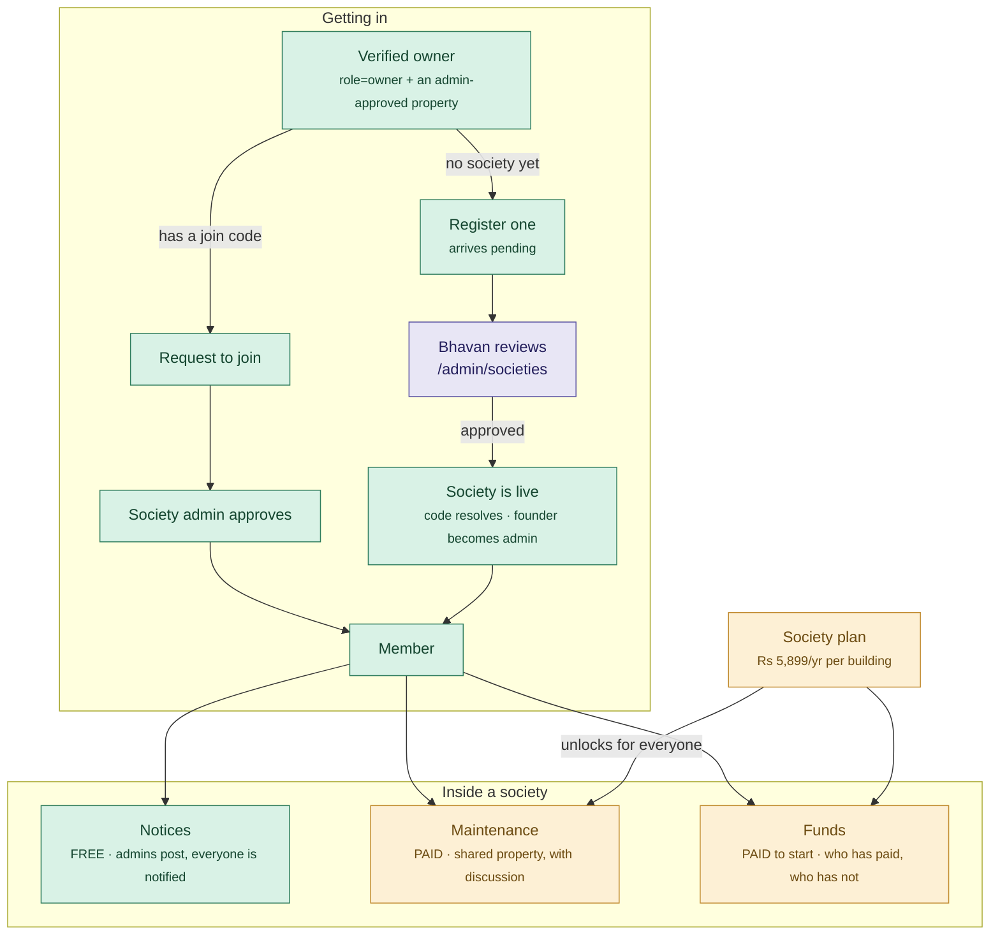

# Bhavan — current workflows

What the app does **today**, drawn from the code rather than the plan.

Sections 1-4 are the original rental product. Section 5 was written as
"where a community feature would attach" while it was still a proposal;
it now describes what was built.

See [ARCHITECTURE.md](ARCHITECTURE.md) for how the pieces are built and
[HANDOVER.md](HANDOVER.md) for what is finished versus what only looks it.

---

## 1. The core loop: tenant finds a flat, owner approves, money moves

Everything else in the app hangs off this. Note that no contact details
are exchanged until the owner approves — that is the product's whole
premise, and the rate limits exist to stop it being farmed by brokers.

**Guards already in place on that loop**

| Guard | Where |
|---|---|
| 5 connection requests per day | Postgres trigger, not the client |
| Contact details hidden until approval | RLS on `connection_requests` |
| Payment amount from the agreement, never the request body | edge function |
| Payment marked paid only on a verified Razorpay signature | edge function |
| Tenant cannot flip a payment to paid | no UPDATE policy on `rent_payments` |

---

## 2. Who verifies what

Two separate review queues, both worked by a Bhavan platform admin. This
is the pipeline a community feature would reuse rather than reinvent.

> **Aadhaar is not actually live.** The edge function is written but returns
> "provider is not configured" until a KYC contract exists. The queue and
> the UI are real; the automated check is not.

### Two ways in, one queue

Proving ownership used to happen only inside the listing flow, so an
owner who lives in their own flat had to advertise their home to the
whole platform just to join their building's society. `/register-flat`
is the same document check without a listing at the end of it, and the
property lands as `self_occupied` rather than the vacant a listing
implies. Both routes land in the same admin queue; a submission with no
listing is badged there, because the reviewer has no photos to
cross-check and the document is the whole case.

Reached from the two places the need actually arises: the society page's
"verify a property first" notice, and a line on the ownership step of
`/list-property`, since that is where owners go when they think "add my
property" -- which is not always the same as "advertise it". There is
deliberately no card for it on the profile; one was built and removed,
because nobody opens their profile thinking they should register their
home.

> **`properties.verified` is Bhavan's output, not the owner's input.**
> Until migration 102 the owner could set it themselves -- RLS grants
> rows, not columns -- which meant self-approving into any society *and*
> awarding themselves the Verified badge, since
> `cascade_property_verification_to_listings` copies the flag onto every
> listing. A trigger now pins it for anyone who is not a platform admin
> or the service role. Replacing the document on an approved property
> drops it back to unverified, so an approval always refers to evidence
> somebody actually looked at.

---

## 3. Roles as they exist today

This matters more than it looks, because "admin" is already taken.

**A community admin is a fourth thing and must not reuse this role.**
Making a building's admin a `users.role = 'admin'` would hand them the
entire platform. Community authority belongs in a membership row scoped to
one community.

### `owner` covers two different people

One rents flats out. The other lives in their own flat and joined Bhavan
for the society. Both are `role = 'owner'`, and the second sees no
tenants, no listings and no income -- three dashboard tiles reading zero
forever.

The split is **per flat, not per person** (`properties.occupancy`, added
in migration 101), because the common case here is somebody who lives in
one flat and lets another, often in the same building. A user-level flag
would be wrong for half their properties the day it was set.

| `occupancy` | Meaning | Set by |
|---|---|---|
| `self_occupied` | The owner lives here | `/register-flat`, and the default |
| `rented_out` | A tenant lives here | The DB, while a rental agreement is live |
| `vacant` | Neither | The DB, when the last agreement lapses |

**Derived, never asked.** Owners briefly had buttons to set this by
hand. It was a row of chrome on every profile for something the app
already knew, and it earned nothing: which half of the dashboard to show
follows from listings and agreements on their own (`isLandlord` in
`src/lib/occupancy.ts`). The column is kept because it is free, it
survives a lapsed agreement, and it tells the review queue that a
submission is somebody's home rather than a half-finished listing.

Two rules worth keeping:

- **Society membership is not evidence of living there.** Landlords stay
  in the society group after renting out -- that is how they hear about
  maintenance and dues. Residence is inferred from the *absence of a
  tenancy on the flat*, never from `community_members`.
- **A live agreement outranks the owner's declaration.** The DB refuses
  to move a flat off `rented_out` while an agreement is running, so a let
  flat cannot be quietly dropped out of the income total. Ending the
  agreement is the way out.

This leaves one case unhandled on purpose: a flat let informally, with
no agreement in Bhavan. The rent is real and the dashboard will read
zero. There is no signal that can tell us, and a checkbox the owner has
to remember only works for people who were already going to do the
paperwork. The fix is to make creating an agreement easy enough that it
stops being skipped, not to add a declaration.

---

## 4. Money today

Both gaps this section used to record have moved.

A **Razorpay webhook** now exists and is deployed, covering rent, Pro and
society payments. It is not yet configured in the Razorpay dashboard, so
until that is done fulfilment still depends on the client returning from
checkout. HANDOVER 4.3 has the two steps.

The claim that **Pro entitlements are enforced in React** was wrong when
it was written, and correcting it is worth keeping visible: they were not
enforced anywhere. Every free-tier limit was Infinity and no code path
read an entitlement. Migration 073 added `has_pro()` as the server-side
check; society entitlements were built on it from the start.

---

## 5. Societies — an apartment complex or villa community

Built after sections 1-4 and additive: nothing above changed. A society is
a group of **verified owners** in one building, reached at `/society`.

**Why the free/paid line sits there.** A society that does nothing until
someone pays is one nobody finishes setting up, and an admin cannot show
the other owners it is worth funding before asking them to fund it. So the
group, the join code and notices are free; the operational tooling is not.
One subscription covers the whole building — the check is
`community_is_paid(community_id)` and never anything about the individual.

**Guards, all in Postgres**

| Guard | Why it exists |
|---|---|
| Joining requires a verified property | The code proves you know the building; verification proves you own a flat in it |
| Join requests land member/pending whatever the client sends | Otherwise anyone with the code appoints themselves |
| A society can never lose its last admin | Both demotion and deletion; otherwise nobody can run it |
| Members are removed by admins, never by themselves | Leaving would erase you from the "who has not paid" list |
| Only a verified Razorpay callback can mark a building paid | `community_subscriptions` has no client INSERT or UPDATE policy |
| A contribution always lands as `claimed` | A claim is not money until an admin finds it in the account |

**What this deliberately is not.** Fund collections are a ledger. Owners
pay the society's own UPI id from their own app; Bhavan records who says
they paid and what the admin confirmed, and never touches the money.
Taking it into a Bhavan account and forwarding it would be payment
aggregator activity under the RBI framework. If in-app payment is wanted
later, the route is Razorpay Route with each society onboarded as a linked
account.

There is also no group chat, on purpose: every one of these buildings
already has a WhatsApp group, and what WhatsApp is bad at is a notice that
does not scroll away and an issue with a status. Discussion is attached to
the ticket it is about, where it self-archives when the issue resolves.
