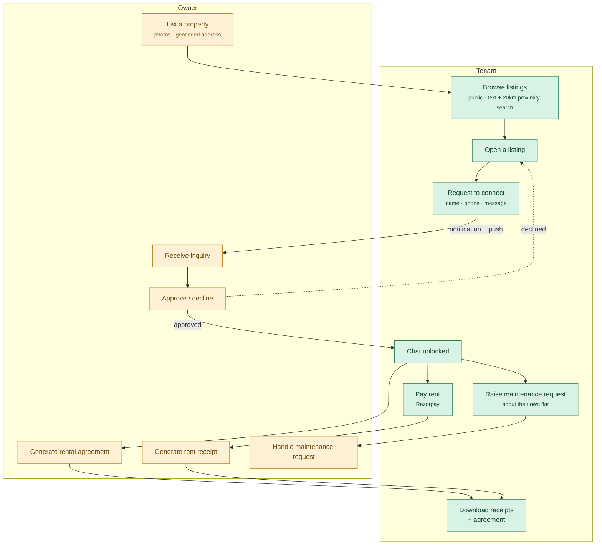
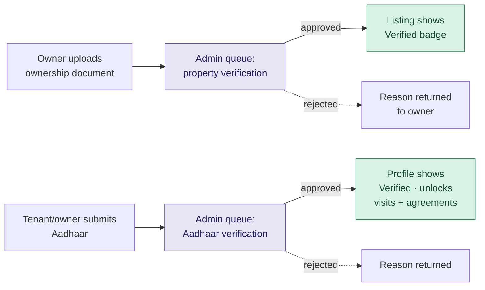
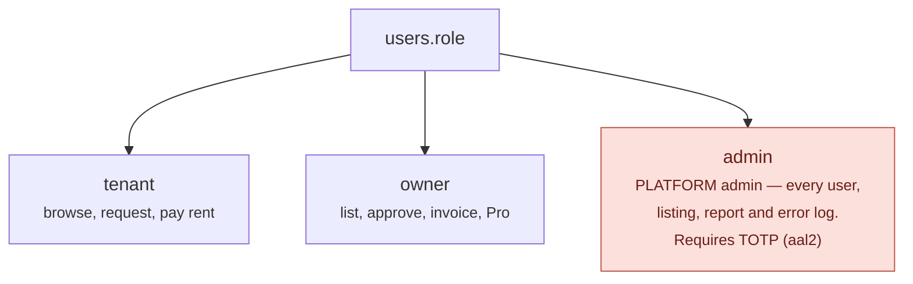
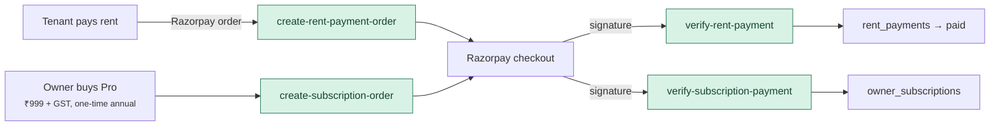
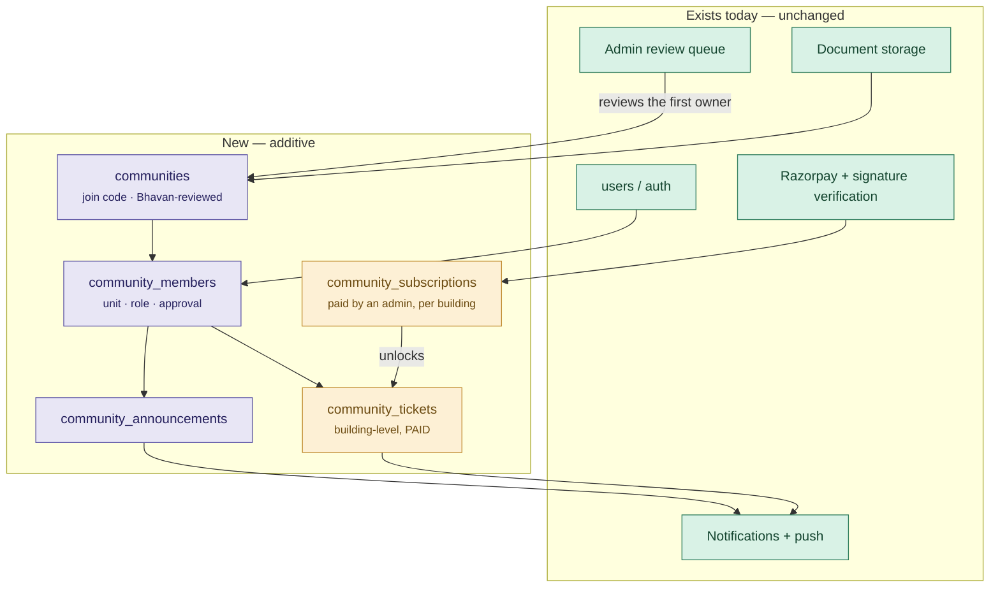

# Bhavan — current workflows

What the app does **today**, before any community/complex work. Drawn from
the code, not from the plan, so it can serve as the baseline that any
proposed change is measured against.

See [ARCHITECTURE.md](ARCHITECTURE.md) for how the pieces are built and
[HANDOVER.md](HANDOVER.md) for what is finished versus what only looks it.

---

## 1. The core loop: tenant finds a flat, owner approves, money moves

Everything else in the app hangs off this. Note that no contact details
are exchanged until the owner approves — that is the product's whole
premise, and the rate limits exist to stop it being farmed by brokers.

**Guards already in place on that loop**

| Guard | Where |
|---|---|
| 5 connection requests per day | Postgres trigger, not the client |
| Contact details hidden until approval | RLS on `connection_requests` |
| Payment amount from the agreement, never the request body | edge function |
| Payment marked paid only on a verified Razorpay signature | edge function |
| Tenant cannot flip a payment to paid | no UPDATE policy on `rent_payments` |

---

## 2. Who verifies what

Two separate review queues, both worked by a Bhavan platform admin. This
is the pipeline a community feature would reuse rather than reinvent.

> **Aadhaar is not actually live.** The edge function is written but returns
> "provider is not configured" until a KYC contract exists. The queue and
> the UI are real; the automated check is not.

---

## 3. Roles as they exist today

This matters more than it looks, because "admin" is already taken.

**A community admin is a fourth thing and must not reuse this role.**
Making a building's admin a `users.role = 'admin'` would hand them the
entire platform. Community authority belongs in a membership row scoped to
one community.

---

## 4. Money today

Two known gaps, both recorded in the handover: there is **no Razorpay
webhook**, so recovery depends on the client returning from checkout; and
**Pro entitlements are enforced in React**, not in the database.

---

## 5. Where a community feature would attach

Nothing above changes. The community model is additive — new tables, new
routes, and it reuses the notification pipeline and the admin review queue
that already exist.

The only existing thing that needs touching is moving Pro entitlement
checks out of React and into RLS — and that is a fix to a known weakness,
not a change in behaviour.
